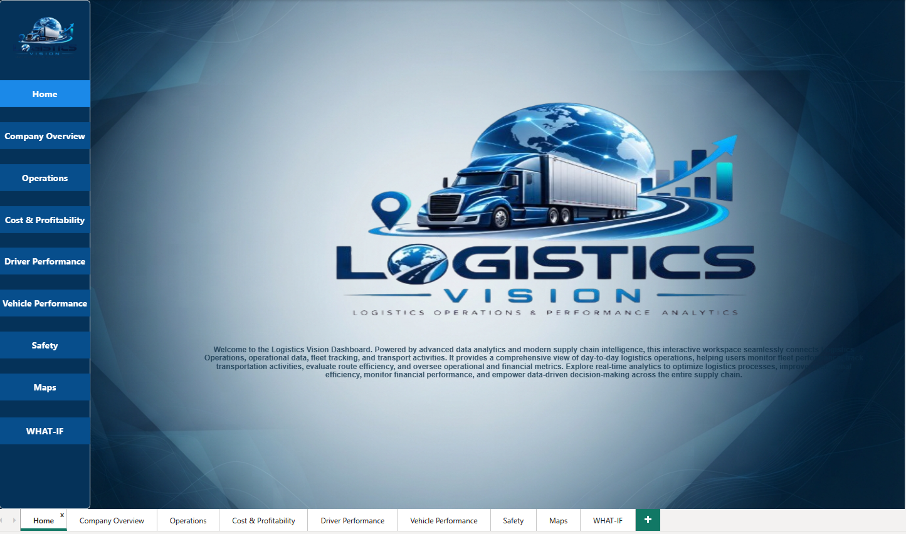
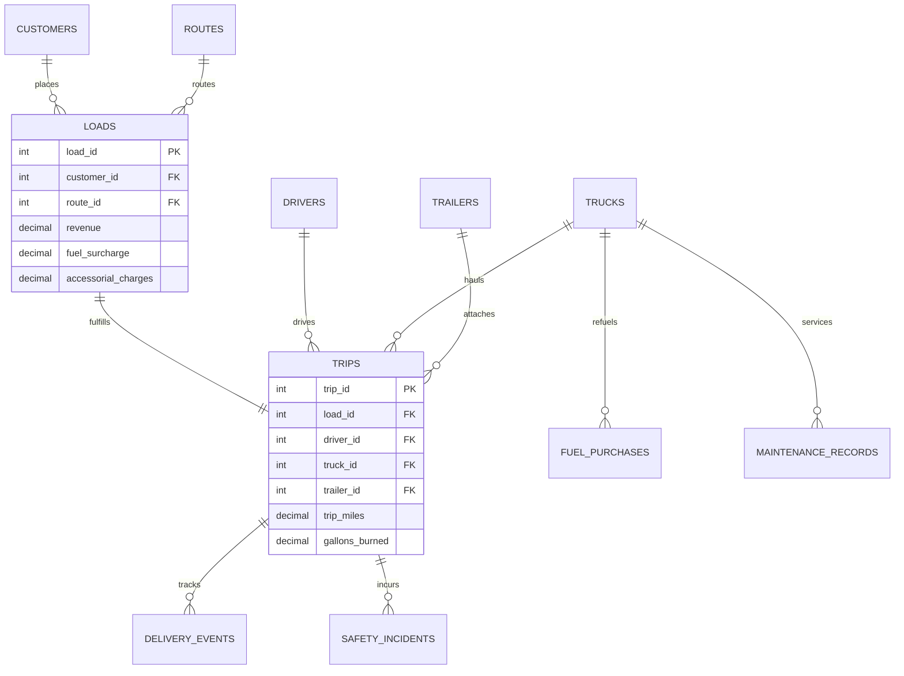
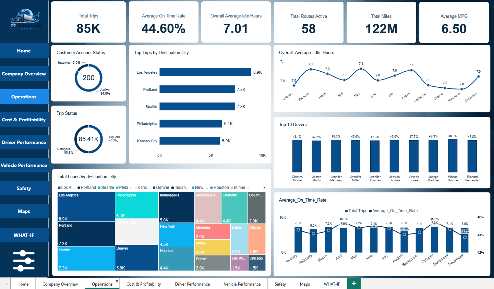
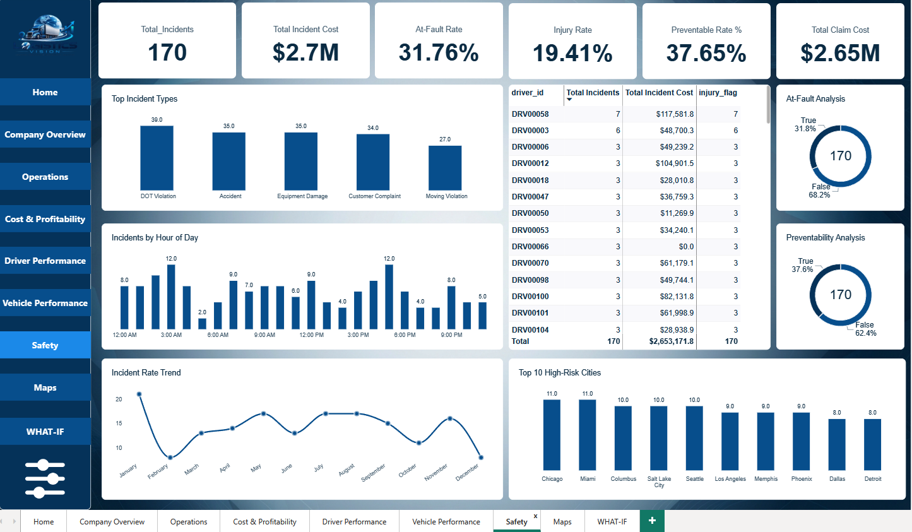
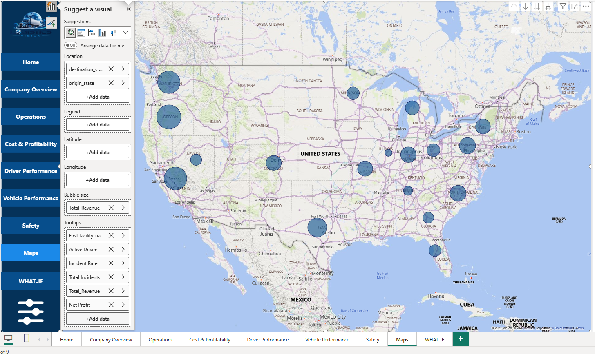

# 🚚 Logistics Vision — Fleet & Supply Chain Analytics Dashboard

<div align="center">



[](https://powerbi.microsoft.com/)
[]()
[]()
[]()
[]()
[](#-presentation-deck--downloads)
[](https://islamyasser424-design.github.io/portfolio-/)

<p align="center">
  <strong>An enterprise-grade, end-to-end Power BI intelligence suite evaluating $298.62M in freight revenue across 85,410 completed shipments, 122.16M fleet miles, fuel balances, operational bottlenecks, driver performance, and dynamic What-If financial simulations (2022–2024).</strong>
</p>

</div>

---

## 📑 Table of Contents
- [Executive Scorecard ($298.62M Operations)](#-executive-scorecard-29862m-operations)
- [Project Team & Institutional Credentials](#-project-team--institutional-credentials)
- [Business Problem & Four Diagnostic Questions](#-business-problem--four-diagnostic-questions)
- [Data Architecture & Five Core Groups (14 Source Datasets)](#-data-architecture--five-core-groups-14-source-datasets)
- [Relational Star Schema & Modeling](#-relational-star-schema--modeling)
- [Key Strategic Analytical Findings](#-key-strategic-analytical-findings)
  - [1. Revenue Yield & Volume-Mix Erosion](#1-revenue-yield--volume-mix-erosion)
  - [2. Systemic Service Delivery Gap (33.28% OTD)](#2-systemic-service-delivery-gap-3328-otd)
  - [3. The 5.57M Gallon Fuel Variance Deficit](#3-the-557m-gallon-fuel-variance-deficit)
  - [4. Fleet Asset Capacity Distortion](#4-fleet-asset-capacity-distortion)
  - [5. Safety Risk Profile: Frequency vs Severity](#5-safety-risk-profile-frequency-vs-severity)
  - [6. Cost Breakdown: The Dominance of Fuel](#6-cost-breakdown-the-dominance-of-fuel)
  - [7. Driver Metric Discrepancy Reconciliation](#7-driver-metric-discrepancy-reconciliation)
  - [8. What-If Financial Sensitivity at $4.50 Fuel](#8-what-if-financial-sensitivity-at-450-fuel)
- [Staged Actionable Roadmap & Governance](#-staged-actionable-roadmap--governance)
- [DAX Formulation Engine & Calculation Reference](#-dax-formulation-engine--calculation-reference)
- [Interactive Dashboard Pages Showcase (9 Pages)](#-interactive-dashboard-pages-showcase-9-pages)
- [Presentation Deck & Downloads](#-presentation-deck--downloads)
- [الدليل التحليلي والتشغيلي الشامل (باللغة العربية)](#-الدليل-التحليلي-والتشغيلي-الشامل-باللغة-العربية)
- [Author & Connect](#-author--connect)

---

## 📊 Executive Scorecard ($298.62M Operations)

The core operational and financial performance across the 3-year audit window (January 2022 – December 2024):

| Metric | Certified Value | Context & Scope |
| :--- | :--- | :--- |
| **Total Freight Revenue** | **$298.62M** | Base freight ($262.53M / 87.91%) + Fuel surcharge ($29.98M / 10.04%) + Accessorials ($6.12M / 2.05%) |
| **Modeled Contribution** | **$141.23M** | Net revenue after direct operational expenses (Fuel, Maintenance, Driver Wages, Incident Damage) |
| **Contribution Margin** | **47.29%** | Modeled contribution / total gross freight revenue |
| **Total Fleet Trip Miles** | **122.16M Miles** | Total distance dispatched and verified across 85,410 line-haul trips |
| **Completed Loads** | **85,410 Loads** | 100% of recorded customer transport orders successfully closed in dispatch |
| **Modeled Cost Per Mile** | **$1.29 / Mile** | Direct operational expense per dispatched line-haul mile |
| **Delivery On-Time Rate (OTD)** | **33.28%** | Timestamp-verified arrival adherence against customer scheduled appointment windows |
| **Fleet Fuel Efficiency** | **6.45 MPG** | Total trip miles (122.16M) / recorded trip fuel burned (18.95M Gallons) |
| **Incident Exposure Rate** | **1.99 / 1,000 Trips** | Safety incident frequency normalized per 1,000 completed line-haul shipments |

---

## 👥 Project Team & Institutional Credentials

* **Diploma Track:** Instant Diploma — Data Analytics Track
* **Analysis Window:** Loads & Trips spanning January 2022 – December 2024
* **Presented by:**
  - **Eng. Abdelwahab Abdallah**
  - **Eng. Eslam Yasser**
  - **Eng. Youssef Hany**
  - **Eng. Mohamed Sami**
* **Instructor:** Eng. Abdelrahman Faraag
* **Mentor:** Eng. Ismail Moustafa
* **Company / Institution:** Instant Software Solutions

---

## 🎯 Business Problem & Four Diagnostic Questions

Modern transportation and fleet logistics require continuous calibration across customer SLA adherence, operational cost structures, and driver safety. This project was framed around four critical diagnostic business questions:

```
┌────────────────────────────────────────────────────────────────────────┐
│                   FOUR CORE LOGISTICS DIAGNOSTIC QUESTIONS             │
├────────────────────┬───────────────────────────────────────────────────┤
│ 1. Service Quality │ Are deliveries meeting scheduled commitments?     │
│                    │ (Baseline: 33.28% OTD vs 90% SLA Target)          │
├────────────────────┼───────────────────────────────────────────────────┤
│ 2. Fuel & Cost     │ Which costs and fuel balances need attention?     │
│                    │ (5.57M gallon purchase-to-burn reconciliation gap)│
├────────────────────┼───────────────────────────────────────────────────┤
│ 3. Asset Capacity  │ Does fleet telematics data reflect true capacity? │
│                    │ (83.04% is a frequency index, not time capacity)  │
├────────────────────┼───────────────────────────────────────────────────┤
│ 4. Inflation Risk  │ How do price and fuel changes affect margins?     │
│                    │ (Testing freight sensitivity at $4.50/gal fuel)   │
└────────────────────┴───────────────────────────────────────────────────┘
```

---

## 🗄️ Data Architecture & Five Core Groups (14 Source Datasets)

The model ingests and reconciles **14 relational source extracts** spanning over **500,000 combined transactional rows**:

```
LOGISTICS DATA UNIVERSE (14 TABLES)
├── 1. Master Data (Structural Dimensions)
│   ├── drivers (150 rows · 13 fields)
│   ├── trucks (120 rows · 11 fields)
│   ├── trailers (180 rows · 9 fields)
│   ├── customers (200 rows · 8 fields)
│   ├── facilities (50 rows · 11 fields)
│   └── routes (589 rows · 9 fields)
├── 2. Operations (Core Activity Facts)
│   ├── loads (85,410 rows · 18 fields)
│   └── trips (85,410 rows · 14 fields)
├── 3. Costs (Operational Expenditures)
│   ├── fuel_purchases (196,442 rows · 12 fields)
│   └── maintenance_records (2,920 rows · 13 fields)
├── 4. Performance & Telematics (Granular Auditing)
│   ├── delivery_events (170,820 rows · 13 fields)
│   ├── driver_monthly_metrics (4,464 rows · 10 fields)
│   └── truck_utilization_metrics (3,312 rows · 10 fields)
└── 5. Safety (Risk Exposure)
    └── safety_incidents (170 rows · 16 fields)
```

---

## 📐 Relational Star Schema & Modeling

The semantic data model is structured around a centralized operational core:



* **Relationships:** 16 total model relationships (14 active 1-to-many, 2 inactive).
* **M Transformations:** Standardized driver names, parsed multi-format timestamps, derived delay minute durations, validated foreign key integrity, and isolated chronology exceptions (486 timestamp inversions preserved for sensitivity testing).

---

## 💡 Key Strategic Analytical Findings

### 1. Revenue Yield & Volume-Mix Erosion
While headline revenue remained stable, decomposed volume-mix-yield analysis revealed underlying contract rate compression:
- **Volume growth in 2024:** Loads grew by **+1.74%**, and top-line revenue increased by **+0.89%**.
- **Yield decline:** Revenue per load dropped by **-0.84%** (falling from $3,524 to $3,494).
- **The Yield Bridge ($2023 vs 2024):** A mathematical bridge across 174 common route/customer segments demonstrated that the decline was driven by a **-$0.898M negative mix effect** (shifting from high-yield spot/dedicated freight to lower-yielding contract freight), offset by only **+$0.063M** in like-for-like pricing yield.

### 2. Systemic Service Delivery Gap (33.28% OTD)
Analysis of **170,820 granular delivery event timestamps** disproved the initial hypothesis of a few "problem routes":
- **Timestamp On-Time Delivery (OTD):** Only **33.28%** of deliveries arrived within their scheduled appointment window (56.72 percentage points below the 90.0% SLA contractual target).
- **Lateness Severity:** Late deliveries experienced a **median delay of 180.05 minutes (3.0 hours)** and a **90th percentile (P90) delay of 324.38 minutes (5.4 hours)**.
- **Dispersion:** The top 5 highest-delay routes accounted for **8.99% of total network volume** and **9.20% of late deliveries**, proving that late arrivals are systemic across the carrier's network rather than concentrated in specific transit corridors.

### 3. The 5.57M Gallon Fuel Variance Deficit
Cross-referencing 196,442 commercial fuel purchases against 85,410 trip fuel consumption logs uncovered a substantial reconciliation gap:
- **Total Fuel Purchased:** **24.52M Gallons** ($95.60M expenditure).
- **Recorded Trip Fuel Burned:** **18.95M Gallons** ($73.88M consumption).
- **Unreconciled Deficit:** **5.57M Gallons (22.73% of purchases)** unaccounted for in direct trip logs.
- **Matched Truck-Month Analysis:** Isolating fuel records to only trucks with verified simultaneous trip activity confirmed that **5.437M gallons of the deficit persist within identical truck-months**, demonstrating that bulk yard purchases, auxiliary idling, or tank transfer leakage require formal inventory accounting.

### 4. Fleet Asset Capacity Distortion
- The source data reported an average fleet utilization of **83.04%**.
- Mathematical auditing proved this is an administrative **trip-frequency ratio** (trips divided by calendar days) rather than true time-based capacity: **436 source records exceeded 100%**, with some trucks registering 160%+.
- True physical fleet availability: Out of 120 power units on file, **92 trucks are active (76.67%)**, **15 are in maintenance (12.50%)**, and **13 are inactive (10.83%)**.

### 5. Safety Risk Profile: Frequency vs Severity
Analysis of 170 recorded safety incidents separated high-frequency regulatory infractions from catastrophic financial exposures:
- **Frequency Leader:** **DOT Violations (39 incidents)** represent the primary operational risk.
- **Financial Severity Leader:** **Equipment Damage ($2.65M total cost)** represents **91.4% of total recorded incident liabilities**.
- **Preventability:** **64 out of 170 incidents (37.65%) were classified as preventable**, providing an immediate target for tailored driver coaching and collision avoidance retrofits.

### 6. Cost Breakdown: The Dominance of Fuel
Modeled operational costs totaled **$157.39M** across the 3-year audit window:
- **Fuel Expense:** **$95.60M (60.74% of operating cost)**.
- **Driver Wages (Estimated):** **$53.41M (33.93% of operating cost)**.
- **Maintenance Records:** **$5.73M (3.64% of operating cost)**.
- **Safety Incident Liabilities:** **$2.65M (1.68% of operating cost)**.

### 7. Driver Metric Discrepancy Reconciliation
Auditing identified two divergent definitions of on-time delivery in operational reporting:
- **Monthly Summary Table:** Reported **44.60% simple average OTD** (44.62% trip-weighted).
- **Delivery Event Timestamps:** Certified **33.28% actual physical OTD**.
- **Root Cause:** Monthly driver summary sheets excluded secondary stops and utilized planned dispatch departure windows rather than final physical gate delivery scans.

### 8. What-If Financial Sensitivity at $4.50 Fuel
Testing the fleet's economic resilience under inflationary diesel fuel price shocks revealed critical pricing thresholds:
- At baseline ($3.8987/gal fuel), modeled contribution stands at **$141.23M**.
- If diesel spikes to **$4.50/gallon**:
  - A **+5% rate uplift on freight alone** yields **$139.62M** (failing to preserve baseline margins, generating a **-$1.61M net loss**).
  - To fully preserve contribution at $4.50 fuel, the carrier requires a **+5.6% across-the-board rate increase** spanning base freight, fuel surcharges, and accessorial charges.

---

## 🗺️ Staged Actionable Roadmap & Governance

```
STAGED IMPLEMENTATION TIMELINE (6-WEEK INITIAL PILOT)
├── P0 (Immediate Model Corrections — Weeks 1 to 2)
│   ├── BI + Operations: Align OTD definitions to timestamp delivery events.
│   └── Fleet + Finance: Establish physical tank inventory balancing for fuel.
├── Short Term (Operational Alignment — Weeks 3 to 4)
│   ├── Commercial: Lock freight rate cards on 174 declining yield segments.
│   └── Dispatch: Pilot 30-minute buffer windows on chronic late corridors.
└── Medium / Long Term (Strategic Optimization — Weeks 5 to 6+)
    ├── Safety: Launch focused remediation coaching on 64 preventable cases.
    └── Fleet Telematics: Deploy time-based engine telemetry (busy vs idle hours).
```

---

## 📐 DAX Formulation Engine & Calculation Reference

Key certified DAX measures utilized across all 9 analytical pages:

```dax
// 1. Total Gross Revenue (Base + Surcharge + Accessorials)
Total_Revenue = 
SUMX(
    loads,
    loads[revenue] + loads[fuel_surcharge] + loads[accessorial_charges]
)

// 2. Modeled Net Contribution
Net Profit = 
[Total_Revenue] - [Total Cost]

// 3. Fleet Fuel Efficiency (Miles Per Gallon)
MPG = 
DIVIDE(
    [Total Miles],
    [Total Gallons Burned],
    0
)

// 4. Operating Cost Per Dispatched Mile
Cost Per Mile = 
DIVIDE(
    [Total Cost],
    [Total Miles],
    0
)

// 5. Certified Timestamp Delivery On-Time Rate
Delivery_OTD_Rate = 
DIVIDE(
    CALCULATE(
        COUNTROWS(delivery_events),
        delivery_events[event_type] = "Delivery",
        delivery_events[real_on_time_flag] = TRUE()
    ),
    CALCULATE(
        COUNTROWS(delivery_events),
        delivery_events[event_type] = "Delivery"
    ),
    0
)
```

---

## 📸 Interactive Dashboard Pages Showcase (9 Pages)

### 1. 🏠 Home & Navigation Portal
Branded landing interface routing executives and analysts into dedicated operations, cost, safety, and telematics modules.


### 2. 🏢 Company Overview
Executive high-level scorecard displaying macro revenue ($298.62M), contribution margins (47.29%), and volumetric load trajectories.


### 3. ⚙️ Operations & On-Time Performance
Line-haul dispatch monitoring, trip status breakdowns, appointment compliance, and delay severity distributions.


### 4. 💰 Cost & Profitability
Decomposed expense structures isolating fuel expenditure ($95.60M), fleet maintenance costs ($5.73M), and driver wage models.


### 5. 👨‍✈️ Driver Performance & Efficiency
Individual driver telematics scorecards evaluating miles logged, fuel burn efficiency (MPG), idle hours, and delivery adherence.


### 6. 🚛 Vehicle Performance & Maintenance Telematics
Power unit utilization rates, maintenance repair categories, active vs down truck status, and fleet service schedules.


### 7. 🛡️ Safety & Risk Exposure
Comprehensive incident tracking separating regulatory DOT violations from vehicle/cargo damage costs ($2.65M) and preventability audits.


### 8. 🗺️ Geospatial Maps & Facility Exposure
Geographic analysis mapping origin-destination corridors, destination revenue concentration, facility density, and regional transit lanes.


### 9. 🔮 What-If Financial & Inflation Scenarios
Dynamic sensitivity simulator allowing executives to model fuel price inflation ($2.00 to $6.00/gal) and rate adjustments (-20% to +50%).


---

## 📑 Presentation Deck & Downloads

* 📊 **Interactive Power BI Dashboard:** [`Final.pbix`](Final.pbix) *(24.8 MB — Full Star Schema & 187 DAX measures)*
* 📑 **Executive Presentation Deck (PDF):** [`Logistics_Vision_Executive_Presentation.pdf`](Logistics_Vision_Executive_Presentation.pdf) *(436 KB — Instant native GitHub in-browser viewer for all 42 slides)*
* 💻 **Executive Presentation Deck (PowerPoint):** [`Logistics_Vision_Executive_Presentation.pptx`](Logistics_Vision_Executive_Presentation.pptx) *(7.78 MB — High-definition competition deck with animations and notes)*
* 🚀 **Release Version:** [Release v1.0.0](https://github.com/islamyasser424-design/Logistics-Vision-Fleet-Supply-Chain-Analytics-Dashboard/releases/tag/v1.0.0)

---

## 📖 الدليل التحليلي والتشغيلي الشامل (باللغة العربية)

### ما هو مشروع Logistics Vision؟
منظومة ذكاء أعمال واستخبارات تشغيلية متكاملة تم بناؤها باستخدام **Microsoft Power BI** لتحليل ومراقبة أسطول النقل وسلاسل الإمداد لشركة لوجستية كبرى على مدار 3 سنوات كاملة (**يناير 2022 – ديسمبر 2024**).

يعتمد المشروع على تحليل **14 جدول بيانات منفصل** بإجمالي يتجاوز **500,000 سجل تشغيلي** و **187 معادلة DAX احترافية** مبنية وفق معمارية الـ **Star Schema**، لتقديم إجابات قاطعة حول ربحية الأسطول، وجودة الخدمة، واستهلاك الوقود، وسيناريوهات التضخم المالي.

---

### أهم النتائج والرؤى الاستراتيجية للمشروع:

1. **النتائج المالية الشاملة (298.62 مليون دولار):**
   - حققت العمليات إجمالي إيرادات بلغ **298.62 مليون دولار** (منها 262.53 مليون شحن أساسي، و 29.98 مليون رسوم وقود إضافية، و 6.12 مليون خدمات تكميلية).
   - بلغ الهامش التشغيلي الصافي (**Modeled Contribution**) **141.23 مليون دولار** بنسبة مساهمة ربحية تمثل **47.29%**.

2. **فجوة الالتزام بمواعيد التسليم (33.28% OTD):**
   - كشف التحليل الزمني الدقيق لـ 170,820 عملية تسليم أن معدل التسليم في الموعد المحدد هو **33.28% فقط** (بفارق 56.7 نقطة مئوية عن مستهدف العقود البالغ 90%).
   - متوسط التأخير للشحنات المتأخرة بلغ **180 دقيقة (3 ساعات)**، ويصل في أوقات الذروة إلى **5.4 ساعات**.
   - أثبت التحليل الإحصائي أن التأخير مشكلة عامة في شبكة المسارات بالكامل وليس محصوراً في مسارات بعينها (أكثر 5 مسارات تأخيراً مسؤولة فقط عن 9.2% من التأخيرات).

3. **فجوة تسوية الوقود (عجز 5.57 مليون جالون):**
   - كشفت المقارنة بين فواتير شراء الوقود (24.52 مليون جالون) والوقود المسجل بالرحلات (18.95 مليون جالون) عن **عجز يبلغ 5.57 مليون جالون (22.73% من إجمالي المشتريات)**.
   - أثبتت المطابقة على مستوى الشاحنة والشهر أن 5.437 مليون جالون من هذا العجز موجود داخل نفس الشاحنات النشطة، مما يتطلب تفعيل جرد الخزانات وسجلات استهلاك المولدات وأوقات السكون (Idling).

4. **تفكيك هيكل التكاليف وهيمنة الوقود:**
   - يمثل الوقود **60.74% من إجمالي التكاليف التشغيلية** بمبلغ **95.60 مليون دولار**، يليه رواتب السائقين بنسبة **33.93% (53.41 مليون دولار)**، ثم الصيانة بنسبة **3.64% (5.73 مليون دولار)**.

5. **محاكاة سيناريوهات التضخم وأسعار الديزل (What-If Analysis):**
   - عند ارتفاع سعر الوقود إلى **4.50 دولار/جالون**، فإن زيادة أسعار الشحن الأساسي بنسبة 5% **غير كافية** وتؤدي إلى تراجع الأرباح بـ 1.61 مليون دولار عن خط الأساس.
   - لحماية الأرباح بالكامل، يتطلب الأمر زيادة شاملة بنسبة **5.6%** تشمل نولون الشحن وضريبة الوقود والخدمات التكميلية معاً.

---

## 👨‍💻 Author & Connect

**Islam Yasser**  
*Data Analyst & Business Intelligence Specialist*  
*Specialized in Power BI, Advanced DAX, Relational Modeling, Fleet Telematics & WFM Analytics*  

* 🌐 **Portfolio Website:** [islamyasser424-design.github.io/portfolio-](https://islamyasser424-design.github.io/portfolio-/)
* 💼 **LinkedIn Profile:** [linkedin.com/in/islam-yasser-55048b378](https://www.linkedin.com/in/islam-yasser-55048b378/)
* 🐙 **GitHub Profile:** [@islamyasser424-design](https://github.com/islamyasser424-design)
* ✉️ **Email:** [islamyasser424@gmail.com](mailto:islamyasser424@gmail.com)

---

<div align="center">
  <sub>Logistics Vision Analytics Suite · Instant Data Analytics Diploma · Designed with Precision</sub>
</div>
